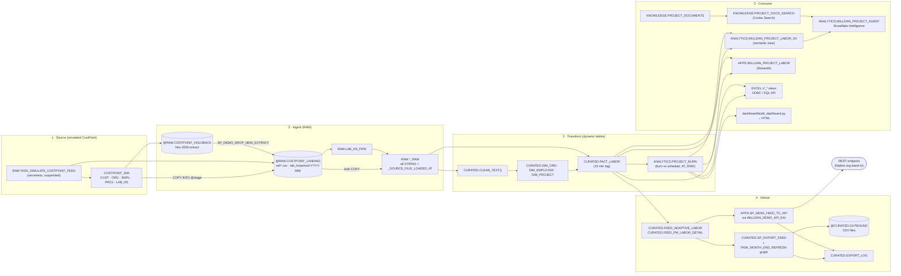

# Architecture

All data is synthetic. Object names below are the ones created by `sql/01..09`.

## Flow summary

1. **Source** — `01_source.sql` builds a CostPoint-shaped, deterministic synthetic dataset
   (2-level WBS, 3-level org, ~14k timesheet lines through 2026-11-04).
2. **Ingest** — `02_ingest.sql` unloads extracts to an internal stage (history by month; November
   held back), bulk-loads RAW tables, and creates a pipe for subsequent monthly files.
3. **Transform** — `03_transform.sql` cleans text and builds the dimension/fact/burn dynamic
   tables, which refresh incrementally as new RAW rows land.
4. **Deliver** — `04_deliver.sql` and `07_apps.sql` produce allowlisted feed files and API pushes,
   both audited in `EXPORT_LOG`, orchestrated by a task graph.
5. **Consume** — `05`/`06` add Cortex Search and the semantic view + agent; `08` adds Excel views
   and a read-only role; the Streamlit app and HTML dashboard read the curated layer.
